<!-- Generado por assets/readme/build.js a partir del portafolio. No editar a mano: cd frontend && yarn readme -->

  <a href="https://jussmoreira-i58n.vercel.app/"><picture><source media="(prefers-color-scheme: dark)" srcset="https://raw.githubusercontent.com/jussmoreira/jussmoreira/main/assets/readme/hero-dark.svg"></picture></a>

  <a href="https://jussmoreira-i58n.vercel.app/"><picture><source media="(prefers-color-scheme: dark)" srcset="https://raw.githubusercontent.com/jussmoreira/jussmoreira/main/assets/readme/pill-portfolio-dark.svg"></picture></a>
  <a href="https://jussmoreira-i58n.vercel.app/JustinMoreiraENG.pdf"><picture><source media="(prefers-color-scheme: dark)" srcset="https://raw.githubusercontent.com/jussmoreira/jussmoreira/main/assets/readme/pill-cv-en-dark.svg"></picture></a>
  <a href="https://jussmoreira-i58n.vercel.app/JustinMoreira.pdf"><picture><source media="(prefers-color-scheme: dark)" srcset="https://raw.githubusercontent.com/jussmoreira/jussmoreira/main/assets/readme/pill-cv-es-dark.svg"></picture></a>
  <a href="https://jussmoreira-i58n.vercel.app/#contact"><picture><source media="(prefers-color-scheme: dark)" srcset="https://raw.githubusercontent.com/jussmoreira/jussmoreira/main/assets/readme/pill-email-dark.svg"></picture></a>
  <a href="https://www.linkedin.com/in/justin-moreira-matarrita"><picture><source media="(prefers-color-scheme: dark)" srcset="https://raw.githubusercontent.com/jussmoreira/jussmoreira/main/assets/readme/pill-linkedin-dark.svg"></picture></a>

  <picture><source media="(prefers-color-scheme: dark)" srcset="https://skillicons.dev/icons?i=java%2Cphp%2Ccs%2Cpython%2Ccpp%2Cjs%2Cc%2Ckotlin%2Cspring%2Claravel%2Cdotnet%2Creact%2Chtml%2Ccss%2Cmysql%2Cpostgres%2Cgit%2Cgithub%2Cdocker%2Carduino%2Cfastapi%2Credis%2Ckafka%2Cts%2Cgithubactions%2Candroidstudio&theme=dark&perline=13"></picture>

  <picture><source media="(prefers-color-scheme: dark)" srcset="https://streak-stats.demolab.com/?user=jussmoreira&hide_border=true&border_radius=2&background=11100d&stroke=aba69c&ring=8097ff&fire=8097ff&currStreakNum=e9e5dd&sideNums=e9e5dd&currStreakLabel=8097ff&sideLabels=aba69c&dates=aba69c"></picture>

  

