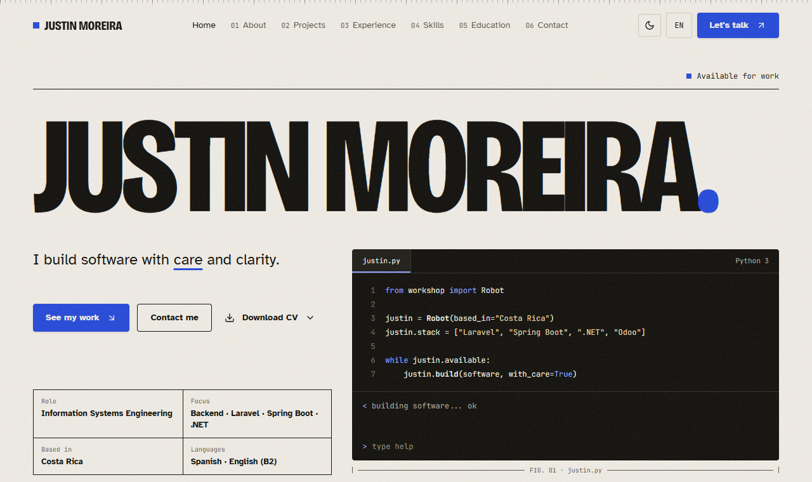

<h1 align="center">Hello, I'm Justin Moreira</h1>
<h3 align="center">Information Systems Engineering student @ UNA | Backend Developer | Laravel · Spring Boot</h3>

  

  <a href="https://jussmoreira-i58n.vercel.app/"><picture><source media="(prefers-color-scheme: dark)" srcset="https://raw.githubusercontent.com/jussmoreira/jussmoreira/main/assets/readme/pill-portfolio-dark.svg"></picture></a>
  <a href="https://jussmoreira-i58n.vercel.app/JustinMoreiraENG.pdf"><picture><source media="(prefers-color-scheme: dark)" srcset="https://raw.githubusercontent.com/jussmoreira/jussmoreira/main/assets/readme/pill-cv-en-dark.svg"></picture></a>
  <a href="https://jussmoreira-i58n.vercel.app/JustinMoreira.pdf"><picture><source media="(prefers-color-scheme: dark)" srcset="https://raw.githubusercontent.com/jussmoreira/jussmoreira/main/assets/readme/pill-cv-es-dark.svg"></picture></a>
  <a href="mailto:jus111moreiramatarrita@gmail.com"><picture><source media="(prefers-color-scheme: dark)" srcset="https://raw.githubusercontent.com/jussmoreira/jussmoreira/main/assets/readme/pill-email-dark.svg"></picture></a>
  <a href="https://www.linkedin.com/in/justin-moreira-matarrita/"><picture><source media="(prefers-color-scheme: dark)" srcset="https://raw.githubusercontent.com/jussmoreira/jussmoreira/main/assets/readme/pill-linkedin-dark.svg"></picture></a>

  <kbd>NOW</kbd> Building <strong>backend web applications and management systems</strong> 
  <kbd>LOOKING FOR</kbd> <strong>My first professional opportunity as a backend developer</strong> 
  <kbd>OPEN TO</kbd> Open source projects · backend applications · automation with RPA 
  <kbd>FUN FACT</kbd> I build robots, teach young people how to code, and inspire them to pursue STEAM careers

<h3 align="left">Selected work</h3>

  <strong>Veterinary management system</strong> · Laravel · MySQL · Scrum 
  Appointments, product catalog and role-based access for a veterinary clinic. University capstone, 2025.

  <strong>REST API with Spring Boot</strong> · Java · JPA · MySQL 
  Layered architecture, DTO mapping and bean validation. 2024.

<h3 align="left">Stack</h3>

  LANGUAGES 
  

  FRAMEWORKS 
  

  DATABASES 
  

  TOOLS 
  

  ROBOTICS &amp; IOT 
  <picture><source media="(prefers-color-scheme: dark)" srcset="https://raw.githubusercontent.com/jussmoreira/jussmoreira/main/assets/readme/leds-board-dark.svg"></picture>

<h3 align="left">This portfolio</h3>

  <a href="https://jussmoreira-i58n.vercel.app/"><picture><source media="(prefers-color-scheme: dark)" srcset="https://raw.githubusercontent.com/jussmoreira/jussmoreira/main/assets/readme/portfolio-dark.png"></picture></a>

  The site in this repository is built with <strong>React 19</strong>, <strong>Tailwind CSS</strong>, Radix UI and i18next (EN/ES), and deployed on Vercel. It has no backend and no router: one page plus a 404.

<ul>
  <li><strong>Terminal in the hero.</strong> Type <code>help</code>. <kbd>Tab</kbd> completes, <kbd>↑</kbd>/<kbd>↓</kbd> repeat, and it can open sections, download the CV or open my profiles.</li>
  <li><strong>Keyboard shortcuts.</strong> <kbd>0</kbd>–<kbd>6</kbd> sections, <kbd>T</kbd> theme, <kbd>/</kbd> terminal, <kbd>?</kbd> help. They never fire while typing.</li>
  <li><strong>Bilingual and themed.</strong> Light/dark and EN/ES, shareable with <code>?lang=es</code>.</li>
  <li><strong>Print-ready.</strong> <kbd>Ctrl</kbd>+<kbd>P</kbd> gives a clean one-column version.</li>
  <li><strong>Quality bar.</strong> WCAG 2.1 AA checked with axe-core, ~127 kB gzipped JavaScript, tests for shortcuts, terminal and locale parity.</li>
</ul>

  Run it: <code>cd frontend &amp;&amp; yarn install &amp;&amp; yarn start</code> (more in <a href="comandos.md">comandos.md</a>). Architecture and conventions: <a href="docs/README.md">docs/</a> (in Spanish).

<h3 align="left">📊 GitHub Stats & Activity</h3>

  

